# vota_dolores_hidalgo

### Ejecución de pruebas


### Prueba en dispositivo

|  | 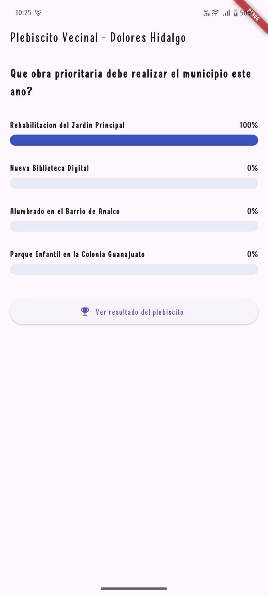 | 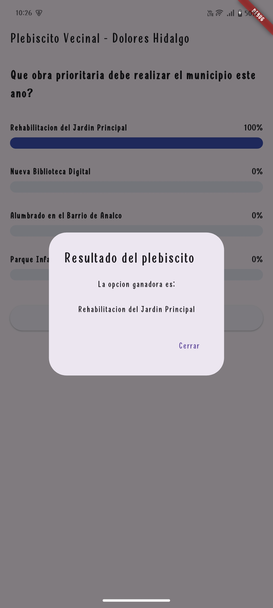 |
| :---: | :---: | :---: |

### Verificación

| Verificación | Estado |
| ------------ | :----: |
| Cada regla de negocio (voto único, opción válida, fecha de cierre, empates) tiene su propia prueba | ✓ |
| ResultadoVoto se usa para casos esperados; no se abusa de excepciones para control de flujo normal | ✓ |
| obtenerResultados() no puede dividir entre cero cuando no hay votos | ✓ |
| La interfaz (VotacionScreen) no duplica ninguna regla ya cubierta por ServicioVotacion | ✓ |
| Existe una prueba de integración que simula un plebiscito completo, incluyendo un intento de voto duplicado | ✓ |

### Desarrollo TDD rehecho paso a paso

Autor: [Diegue83](https://github.com/Diegue83)

El código se volvió a escribir desde cero siguiendo el manual, ejecutando las pruebas una por una
(rojo → verde → refactor). La bitácora con cada fallo y cada éxito real está en
[docs/BITACORA_TDD.md](docs/BITACORA_TDD.md), y la salida de consola de cada ejecución en
[docs/evidencias/](docs/evidencias/).

| Paso | Rojo | Verde |
| ---- | :--: | :---: |
| Ronda 1 – voto válido | ❌ | ✅ |
| Ronda 2 – opción inexistente | ❌ | ✅ |
| Ronda 3 – voto duplicado | ❌ | ✅ |
| Ronda 4 – porcentajes | ❌ | ✅ |
| Ronda 5 – ganador | ❌ | ✅ |
| Ronda 6 – empate | (pasó a la primera) | ✅ |
| Ronda 7 – votación cerrada | ❌ | ✅ |
| Ronda 8 – refactor | — | ✅ |
| Integración | (pasó a la primera) | ✅ |

**Resultado final: 10 pruebas en verde.**

### Evidencia de cada prueba en VS Code

Rama: `tdd-capturas-vscode` · Usuario de GitHub: [Diegue83](https://github.com/Diegue83)

El código se copió del manual ronda por ronda y, en cada paso, se ejecutó en VS Code
(Terminal → Ejecutar tarea → **TDD: todas las pruebas**):

```bash
flutter test test/servicio_votacion_test.dart --reporter expanded
```

Cada captura muestra el resultado en la terminal y la cuenta **Diegue83 (GitHub)** con sesión iniciada en VS Code.

| Paso | Resultado | Captura |
| ---- | --------- | :-----: |
| Ronda 1 – Rojo | ❌ No compila: `ServicioVotacion` no existe | [01](docs/capturas_vscode/01_ronda1_rojo.jpg) |
| Ronda 1 – Verde | ✅ 1/1 | [02](docs/capturas_vscode/02_ronda1_verde.jpg) |
| Ronda 2 – Rojo | ❌ `Null check operator used on a null value` | [03](docs/capturas_vscode/03_ronda2_rojo.jpg) |
| Ronda 2 – Verde | ✅ 2/2 | [04](docs/capturas_vscode/04_ronda2_verde.jpg) |
| Ronda 3 – Rojo | ❌ Esperado `usuarioYaVoto`, se obtuvo `exitoso` | [05](docs/capturas_vscode/05_ronda3_rojo.jpg) |
| Ronda 3 – Verde | ✅ 3/3 | [06](docs/capturas_vscode/06_ronda3_verde.jpg) |
| Ronda 4 – Rojo | ❌ `obtenerResultados` no está definido | [07](docs/capturas_vscode/07_ronda4_rojo.jpg) |
| Ronda 4 – Verde | ✅ 5/5 | [08](docs/capturas_vscode/08_ronda4_verde.jpg) |
| Ronda 5 – Rojo | ❌ `determinarGanador` no está definido | [09](docs/capturas_vscode/09_ronda5_rojo.jpg) |
| Ronda 5 – Verde | ✅ 6/6 | [10](docs/capturas_vscode/10_ronda5_verde.jpg) |
| Ronda 6 – Empate | ✅ 7/7 (pasa sin cambiar código) | [11](docs/capturas_vscode/11_ronda6_empate.jpg) |
| Ronda 7 – Rojo | ❌ Esperado `votacionCerrada`, se obtuvo `exitoso` | [12](docs/capturas_vscode/12_ronda7_rojo.jpg) |
| Ronda 7 – Verde | ✅ 9/9 | [13](docs/capturas_vscode/13_ronda7_verde.jpg) |
| Ronda 8 – Refactor | ✅ 9/9 | [14](docs/capturas_vscode/14_ronda8_refactor.jpg) |
| Integración | ✅ 10/10 | [15](docs/capturas_vscode/15_integracion.jpg) |

#### Ronda 1
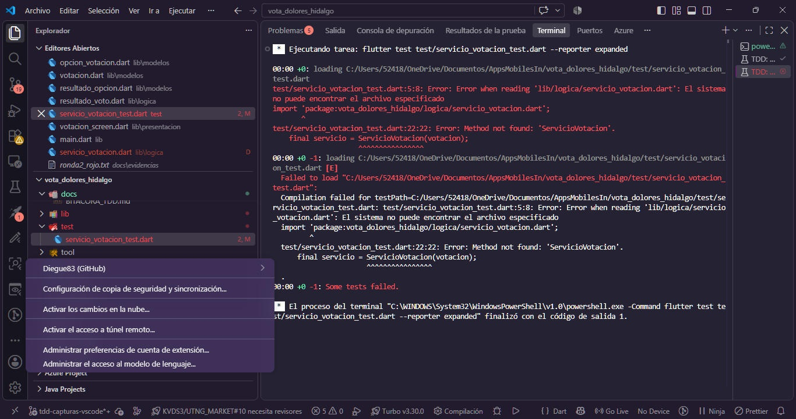
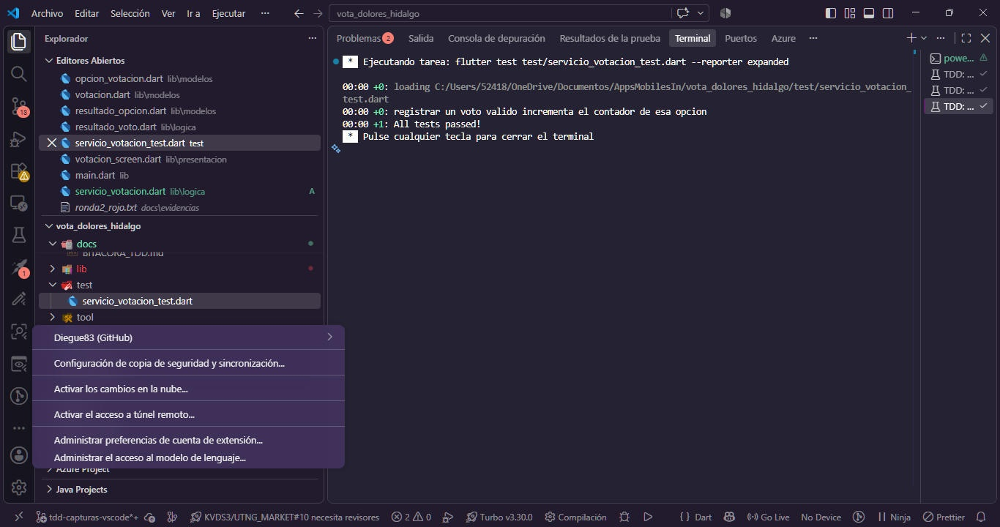

#### Ronda 2
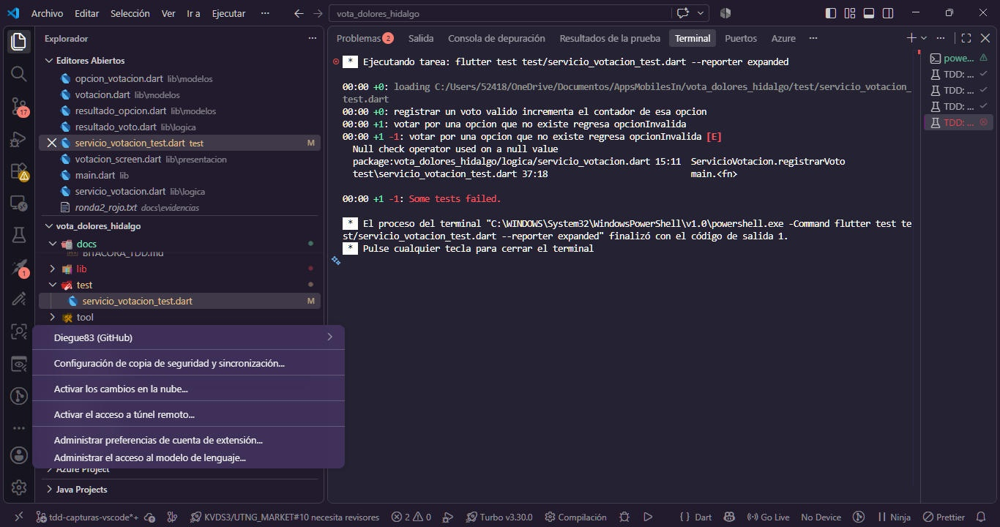
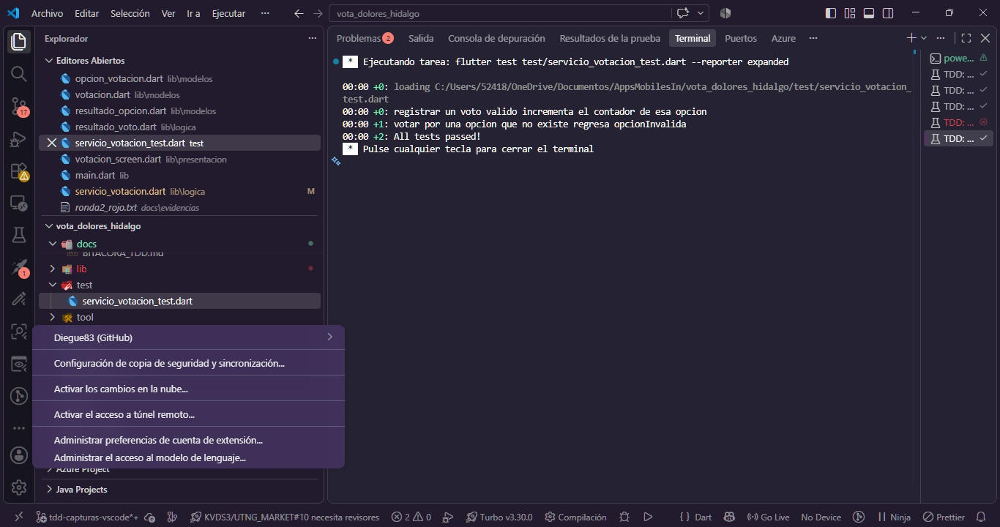

#### Ronda 3
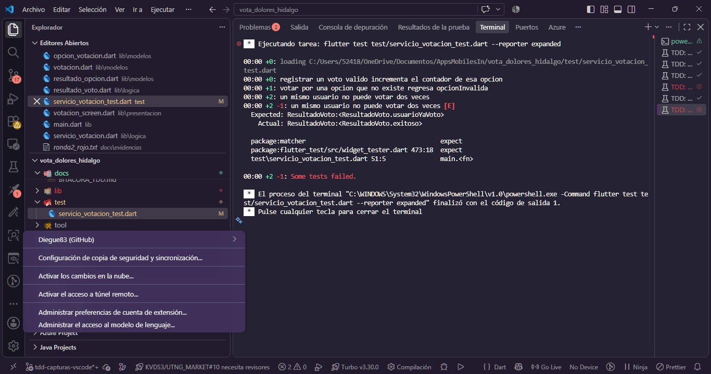
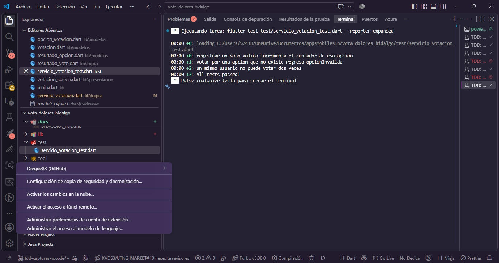

#### Ronda 4
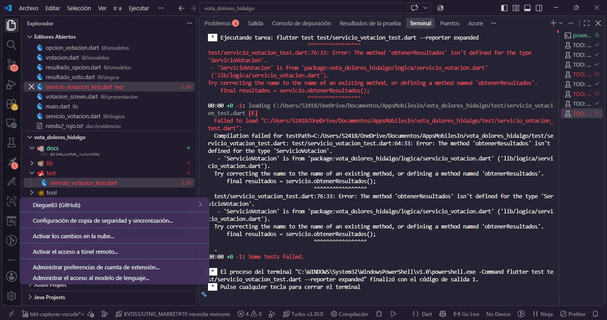
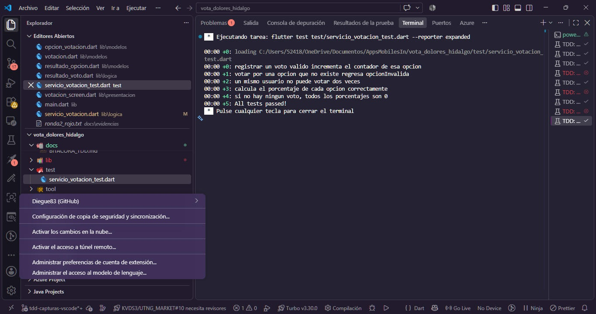

#### Ronda 5
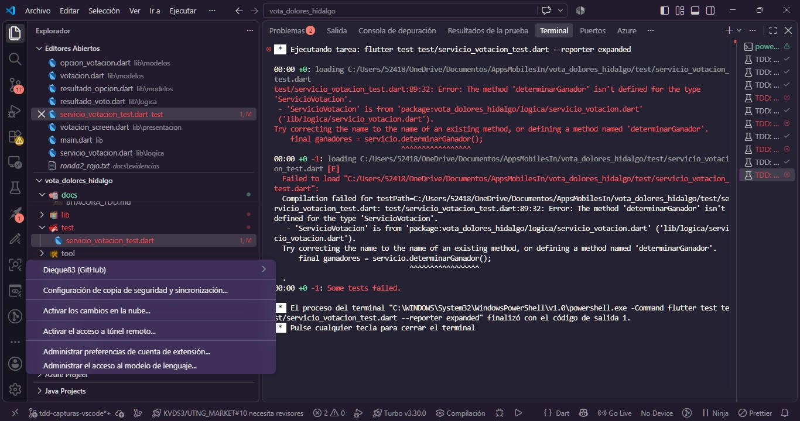
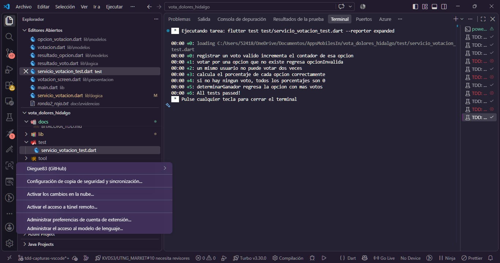

#### Ronda 6
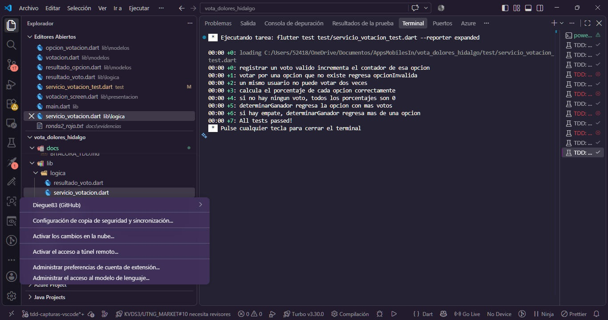

#### Ronda 7
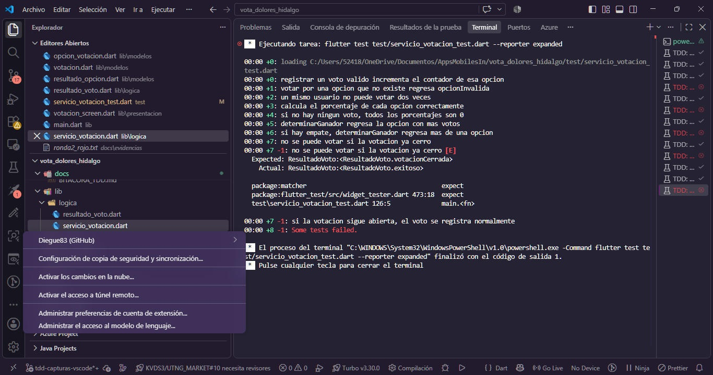
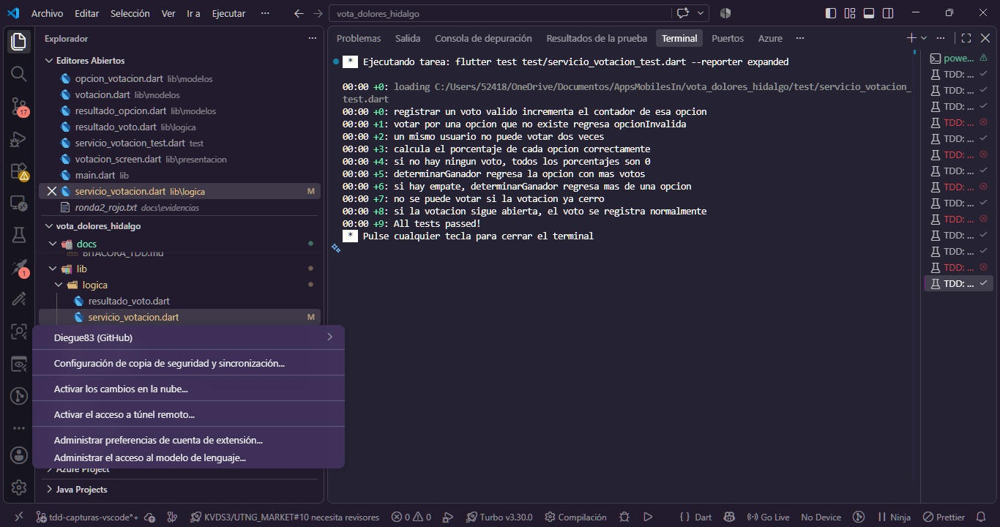

#### Ronda 8
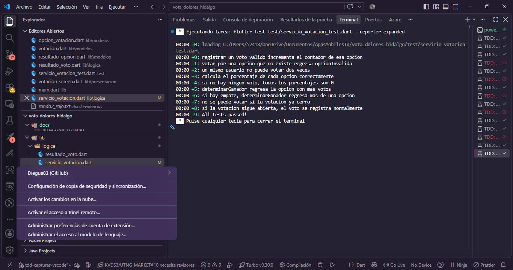

#### Integración
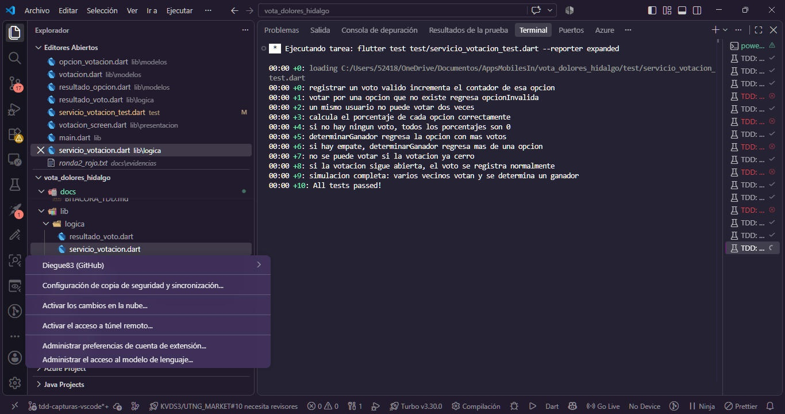
