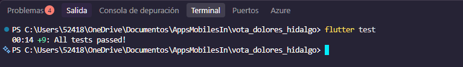
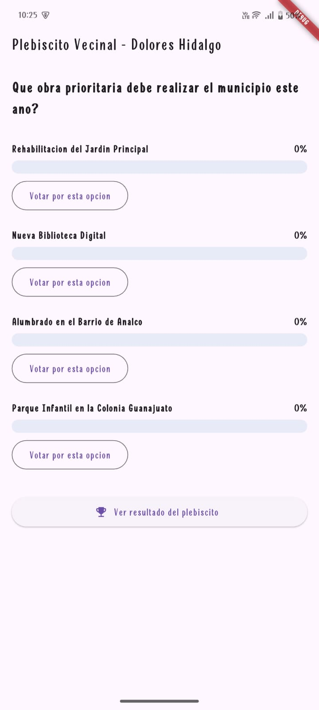

# vota_dolores_hidalgo

### Ejecución de pruebas

### Prueba en dispositivo

|  |  |  |
| :---: | :---: | :---: |

### Verificación

| Verificación | Estado |
| ------------ | :----: |
| Cada regla de negocio (voto único, opción válida, fecha de cierre, empates) tiene su propia prueba | ✓ |
| ResultadoVoto se usa para casos esperados; no se abusa de excepciones para control de flujo normal | ✓ |
| obtenerResultados() no puede dividir entre cero cuando no hay votos | ✓ |
| La interfaz (VotacionScreen) no duplica ninguna regla ya cubierta por ServicioVotacion | ✓ |
| Existe una prueba de integración que simula un plebiscito completo, incluyendo un intento de voto duplicado | ✓ |

### Desarrollo TDD rehecho paso a paso

Autor: [Diegue83](https://github.com/Diegue83)

El código se volvió a escribir desde cero siguiendo el manual, ejecutando las pruebas una por una
(rojo → verde → refactor). La bitácora con cada fallo y cada éxito real está en
[docs/BITACORA_TDD.md](docs/BITACORA_TDD.md), y la salida de consola de cada ejecución en
[docs/evidencias/](docs/evidencias/).

| Paso | Rojo | Verde |
| ---- | :--: | :---: |
| Ronda 1 – voto válido | ❌ | ✅ |
| Ronda 2 – opción inexistente | ❌ | ✅ |
| Ronda 3 – voto duplicado | ❌ | ✅ |
| Ronda 4 – porcentajes | ❌ | ✅ |
| Ronda 5 – ganador | ❌ | ✅ |
| Ronda 6 – empate | (pasó a la primera) | ✅ |
| Ronda 7 – votación cerrada | ❌ | ✅ |
| Ronda 8 – refactor | — | ✅ |
| Integración | (pasó a la primera) | ✅ |

**Resultado final: 10 pruebas en verde.**
